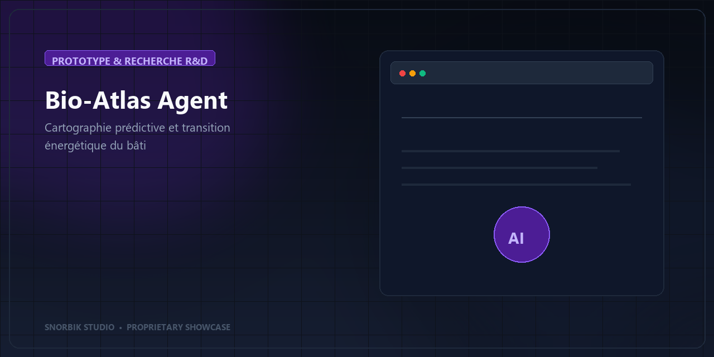

# Bio-Atlas Agent — Cartographie Prédictive & Transition Énergétique

> **Programme d'exploration en modélisation spatiale et simulation d'efficacité énergétique des bâtiments.**

---

> [!NOTE]
> **Statut du Projet :** Concept & Programme de Recherche R&D (SNORBIK Studio).

---

## Vocation du Projet

**Bio-Atlas Agent** est un concept exploratoire visant à appliquer l'intelligence de données et la modélisation spatiale au défi de la rénovation énergétique du patrimoine bâti. Il étudie des méthodologies d'analyse pour cartographier les passoires thermiques et mesurer l'impact prévisionnel des travaux d'isolation.

---

## Domaines d'Exploration

- **Collectivités & Territoires** : Aide à la décision pour le ciblage des programmes de rénovation thermique.
- **Bailleurs & Gestionnaires Immobiliers** : Évaluation globale de la performance énergétique d'un parc de logements.
- **Urbanisme & Climat** : Modélisation des îlots de chaleur et optimisation de l'empreinte carbone urbaine.

---

## Axes de Recherche

- **Agrégation Multi-Sources** : Croisement des diagnostics de performance énergétique (DPE), données cadastrales et relevés météorologiques.
- **Scénarios Prédictifs** : Estimation automatisée des gains énergétiques et des réductions de gaz à effet de serre selon les typologies de travaux.
- **Visualisation Cartographique** : Restitution claire et accessible sous forme d'indicateurs de décision synthétiques.

---

## Démonstration Conceptuelle

🎥 **[Voir la vidéo de présentation conceptuelle](./assets/presentation-video/product-presentation.mp4)**

---

## Échanger sur ce Programme de Recherche

Ce projet illustre la démarche de recherche et d'innovation menée par **SNORBIK Studio**.

- 🌐 **Découvrir l'ensemble de nos travaux :** [Accéder au Portfolio SNORBIK Studio](https://snorbik.com)
- 🤝 **Proposer une collaboration ou un cas d'étude :** [Échanger avec notre pôle R&D](https://snorbik.com/rendez-vous)

---
© 2026 **SNORBIK Studio** — Tous droits réservés. Programme conceptuel d'innovation.
